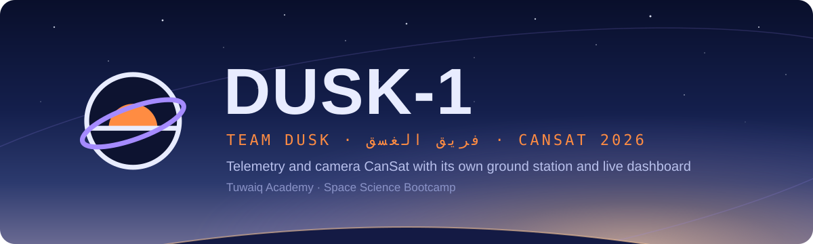
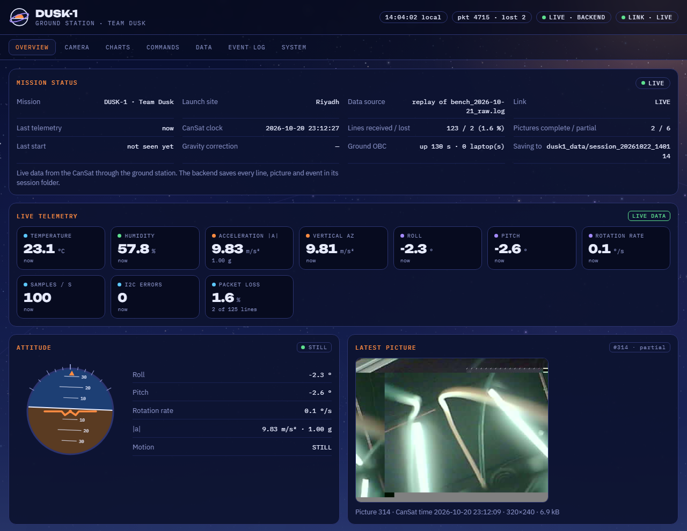
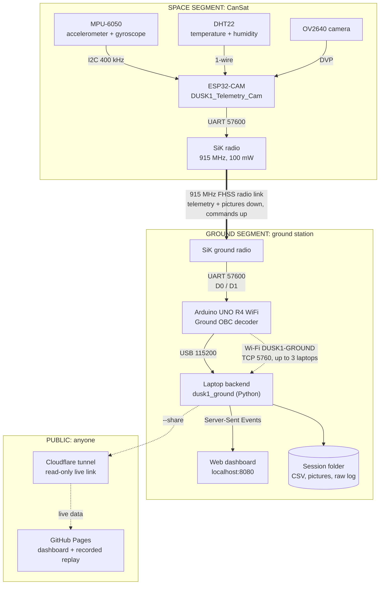
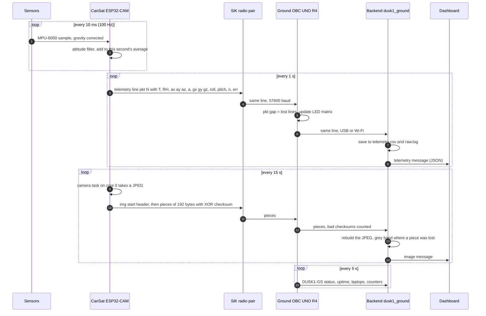
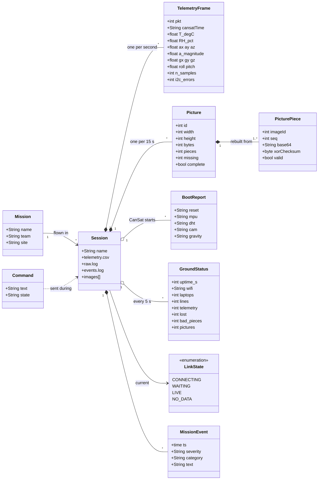
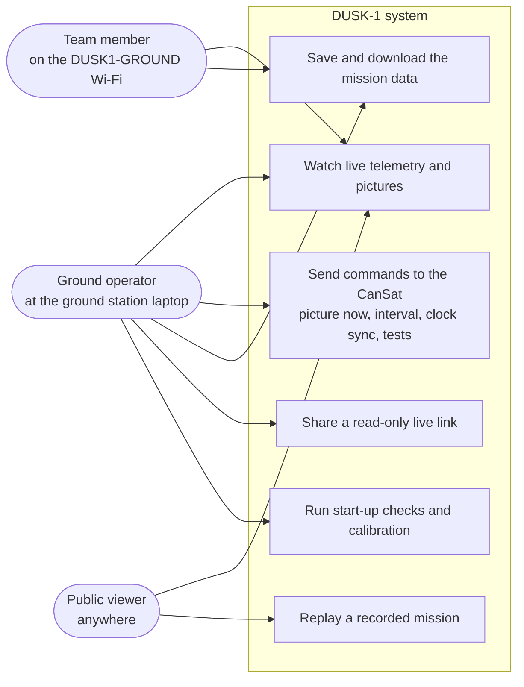
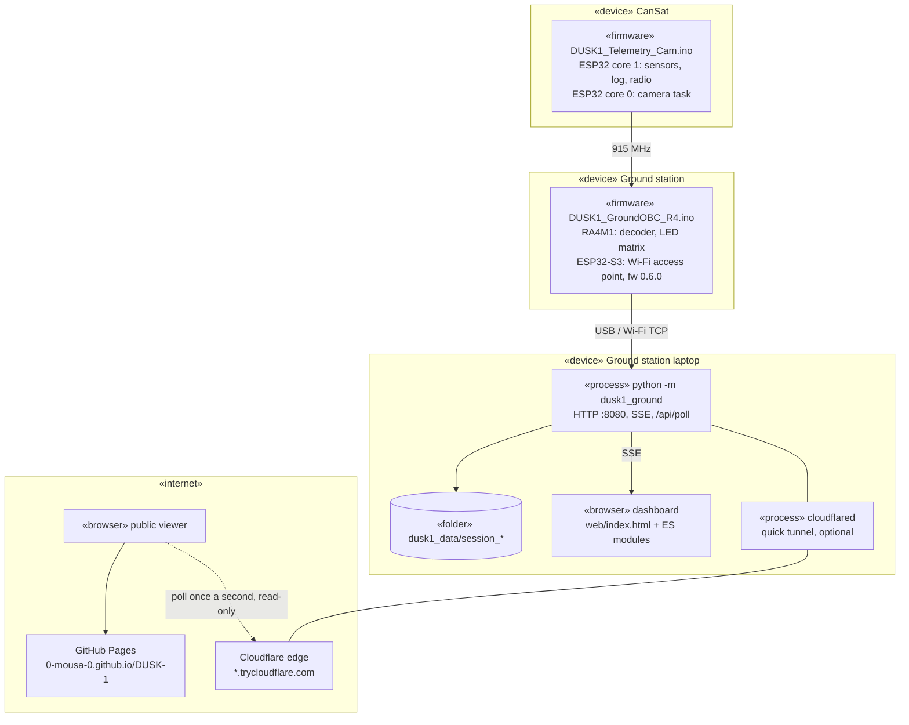
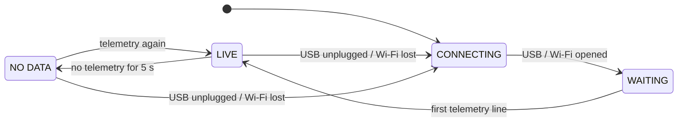
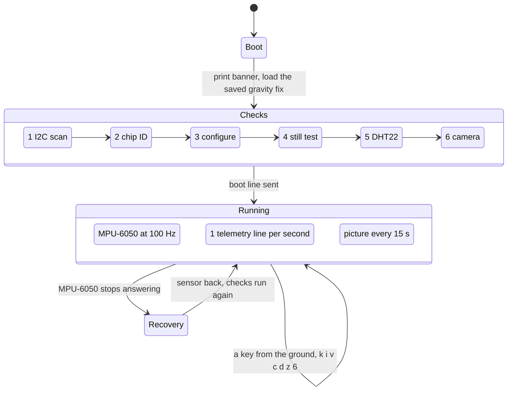

<p align="center"></p>

<p align="center">
  <a href="https://0-mousa-0.github.io/DUSK-1/"><b>Open the live dashboard</b></a> ·
  <a href="https://github.com/0-Mousa-0/DUSK-1/tree/space-segment/space-segment">Space segment</a> ·
  <a href="https://github.com/0-Mousa-0/DUSK-1/tree/ground-segment/ground-segment">Ground segment</a>
</p>

# DUSK-1

**DUSK-1** is the CanSat of **Team Dusk** (فريق الغسق), built at the **Tuwaiq Academy Space Science Bootcamp** for **CanSat 2026**.
It is a can-sized satellite that measures its environment and its own motion, takes pictures, and sends everything
live over a 915 MHz radio to a ground station we also built. The ground station decodes every line, saves the
whole mission to disk and shows it on a web dashboard that anyone can open.

> *Dusk* (الغسق) is the moment between day and night. Our logo is the sun on the horizon inside an orbit ring:
> the sky we launch into, and the path back down.

| | |
|---|---|
| **Measures** | temperature, humidity, 3-axis acceleration, 3-axis rotation, attitude (roll, pitch) |
| **Sees** | a 320×240 JPEG picture every 15 s from its OV2640 camera |
| **Sends** | one telemetry line per second plus the pictures, over a SiK 915 MHz radio at 57 600 baud |
| **Ground station** | SiK ground radio → Arduino UNO R4 WiFi decoder → laptop backend → web dashboard |
| **Public** | dashboard on GitHub Pages, with a recorded mission replay and a read-only live link |
| **Bench result** (2026-10-21) | 33 min through the radio: 1 477 telemetry lines, 1.1 % lost, 100 pictures received |

<p align="center"></p>

---

## Contents

1. [How the repository is organised](#how-the-repository-is-organised)
2. [System structure](#system-structure)
3. [The mission data, end to end](#the-mission-data-end-to-end)
4. [Project entities (UML)](#project-entities-uml)
5. [Quick start](#quick-start)
6. [Results and lessons from integration](#results-and-lessons-from-integration)
7. [Team](#team)

---

## How the repository is organised

The project has two segments, as every space mission does. Each has its own branch with its code, its
equipment list and a full explanation.

| Branch | What is in it | Read |
|---|---|---|
| **`main`** | this page: identity, system structure, UML diagrams | you are here |
| **`space-segment`** | the CanSat: ESP32-CAM firmware, sensors, camera, radio, wiring, start-up checks, protocol | [space-segment/README.md](https://github.com/0-Mousa-0/DUSK-1/blob/space-segment/space-segment/README.md) |
| **`ground-segment`** | the ground station: radio setup, UNO R4 WiFi decoder firmware, the Python backend, the web dashboard, tools, tests, deployment | [ground-segment/README.md](https://github.com/0-Mousa-0/DUSK-1/blob/ground-segment/ground-segment/README.md) |

```
DUSK-1/                                 (each branch adds its own folder to what main has)
├── README.md                           main: identity, structure, UML
├── docs/assets/                        banner, dashboard pictures
├── space-segment/                      branch space-segment
│   ├── README.md                       equipment, wiring, firmware explained
│   └── firmware/DUSK1_Telemetry_Cam/   CanSat firmware (Arduino, AI Thinker ESP32-CAM)
└── ground-segment/                     branch ground-segment
    ├── README.md                       equipment, radio setup, software explained
    ├── obc-firmware/DUSK1_GroundOBC_R4/ Ground OBC firmware (Arduino UNO R4 WiFi)
    ├── ground-station/
    │   ├── dusk1_ground/               backend (Python package, SOLID modules)
    │   ├── web/                        dashboard (HTML + CSS + JavaScript modules)
    │   ├── tests/                      Python and JavaScript tests
    │   ├── sample_data/                recorded sessions
    │   └── start_ground_station.bat    double-click launcher (Windows)
    └── tools/sik_radio_config.py       read / set the SiK radios
```

---

## System structure



**Why it is built this way**

* **The CanSat only measures and sends.** Every second it prints one self-describing text line; pictures go in
  numbered, checksummed pieces between those lines. The radio is transparent: whatever the CanSat prints, the
  ground radio prints.
* **The Ground OBC is a decoder, not a display.** The UNO R4 WiFi checks packet numbers and picture checksums,
  adds its own status line every 5 s, and shares the stream over USB and over its own Wi-Fi network, so up to
  three laptops get the data even with no internet.
* **The laptop backend owns the data.** It saves every byte (`raw.log`), every telemetry row (`telemetry.csv`),
  every picture and every event, and pushes it all live to the dashboards.
* **The dashboard runs anywhere.** On the ground station laptop it is live, with commands. On GitHub Pages it plays
  a recorded mission, or follows a live mission read-only through a public link.

---

## The mission data, end to end



---

## Project entities (UML)

### Domain model

What the system talks about. The same entities exist in the CanSat's text protocol, in the backend
(`dusk1_ground/protocol.py`, `messages.py`) and in the dashboard (`web/js/core/store.js`).



### Actors and what they do



### Deployment



### Link state

What the dashboard header shows, and when it changes.



### CanSat life cycle



More diagrams live with the code they describe: the firmware architecture and the picture protocol in the
[space segment](https://github.com/0-Mousa-0/DUSK-1/blob/space-segment/space-segment/README.md), the backend and
dashboard class diagrams (SOLID) in the [ground segment](https://github.com/0-Mousa-0/DUSK-1/blob/ground-segment/ground-segment/README.md).

---

## Quick start

**Just look:** open **https://0-mousa-0.github.io/DUSK-1/**. It plays our recorded bench session: real data that
went through the radio.

**Run the whole system** (details in each segment's README):

1. **CanSat:** upload `space-segment/firmware/DUSK1_Telemetry_Cam` to the AI Thinker ESP32-CAM (Arduino IDE, no libraries).
2. **Radios:** give both SiK radios the same private network ID (`ground-segment/tools/sik_radio_config.py`).
3. **Ground OBC:** update the UNO R4 WiFi's Wi-Fi firmware to 0.6.0, upload `ground-segment/obc-firmware/DUSK1_GroundOBC_R4`, wire the ground radio to D0/D1.
4. **Laptop:** double-click `ground-segment/ground-station/start_ground_station.bat`, choose **1** (USB) and the R4's COM port.
5. **Watch:** http://localhost:8080 goes LIVE. Choose **5** instead of 1 to also get a public read-only link.

---

## Results and lessons from integration

The first complete run, CanSat to dashboard through the radio, was on **2026-10-21**:

| Measured | Result |
|---|---|
| Duration | 1 955 s (33 min) |
| Telemetry lines received | 1 477, with 16 lost (**1.1 %**) |
| Pictures | 100 received: 69 complete, 31 with one or two of ~38 pieces missing |
| Sensors at rest | \|a\| = 9.80–9.85 m/s² (1.00 g), gyro under 0.2 °/s, 100 samples/s, 0 I2C errors |

Getting there taught us three things worth keeping:

1. **Radios pair by network ID, not by box.** Our two radios came with different NETIDs (20 and 25), and the one on
   the factory value 25 had quietly paired with *another team's* radio nearby. Both now share a private NETID.
2. **A blocking call can look like a radio problem.** The UNO R4 WiFi's Wi-Fi chip ran firmware 0.2.1, which never
   answers the "new laptop?" check, so every check froze the board for its 10 s timeout and 83 % of the radio data
   overflowed a 512-byte buffer. Wi-Fi firmware 0.6.0 fixed it: from 17 % to 98 % delivered, same hardware.
3. **Measure before guessing.** Each fix came from a number (`lines 0`, a status line every 10.1 s instead of 5 s,
   RSSI and packet counters read from the radios), not from swapping parts.

---

## Team

**Team Dusk · فريق الغسق**, Tuwaiq Academy Space Science Bootcamp, CanSat 2026, Riyadh.
