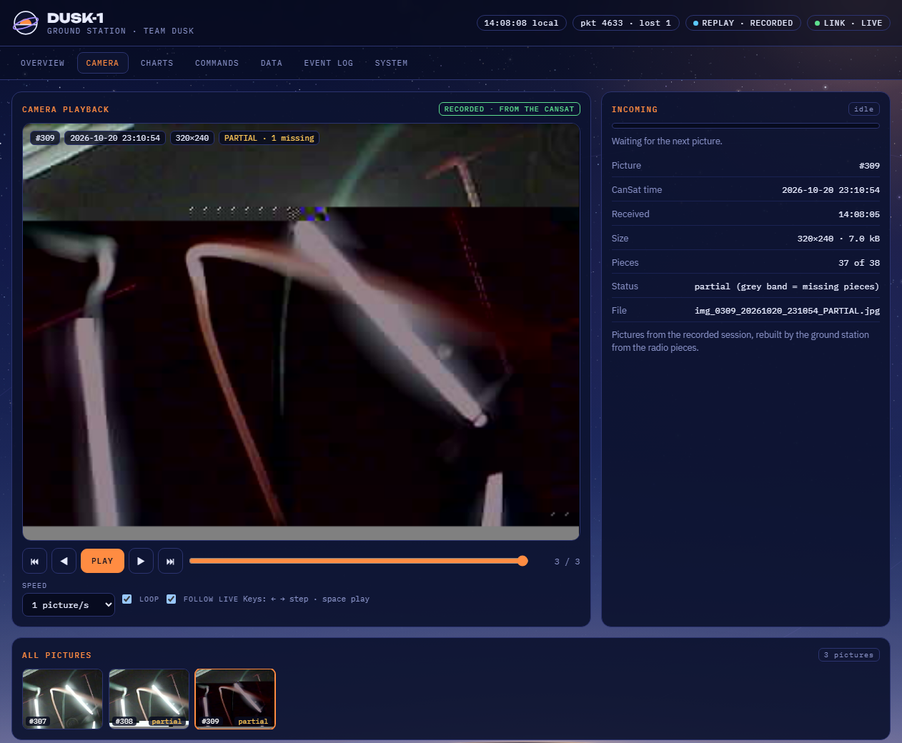
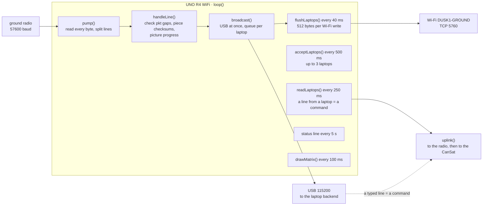
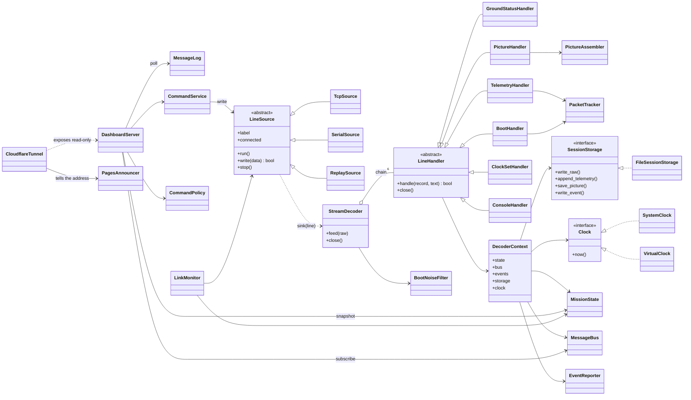
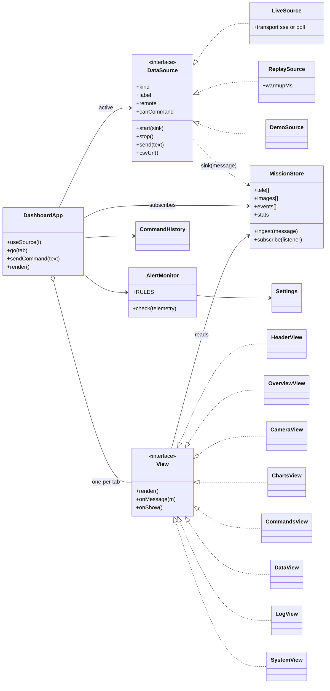
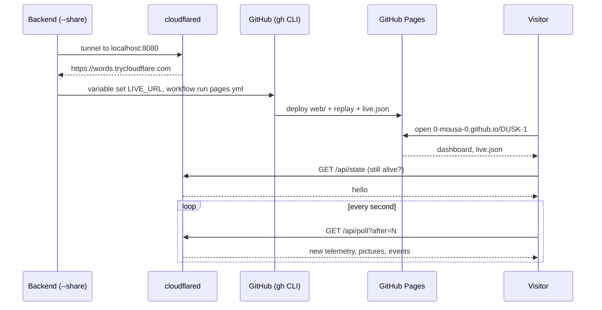
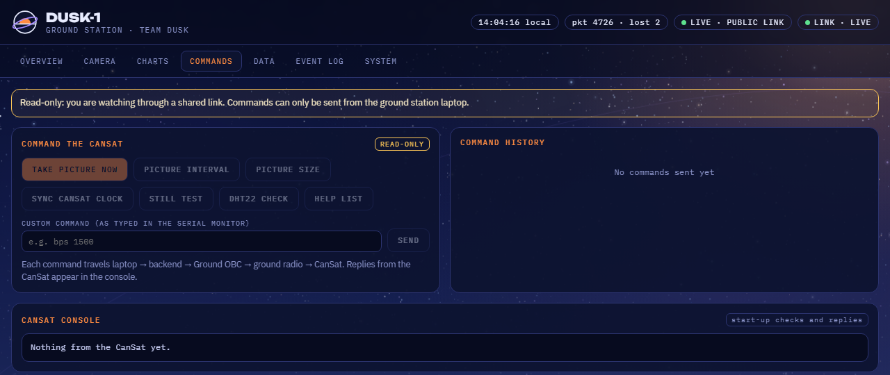

<p align="center"></p>

# Ground segment · the DUSK-1 ground station

The ground station receives the CanSat's radio stream, decodes it, saves the whole mission and shows it live.
It has three parts, each in its own folder:

| Part | Folder | Runs on |
|---|---|---|
| **Ground OBC** (decoder) | [`obc-firmware/DUSK1_GroundOBC_R4`](obc-firmware/DUSK1_GroundOBC_R4/DUSK1_GroundOBC_R4.ino) | Arduino UNO R4 WiFi, wired to the ground radio |
| **Backend** | [`ground-station/dusk1_ground`](ground-station/dusk1_ground) | the laptop, Python 3 |
| **Dashboard** | [`ground-station/web`](ground-station/web) | any browser: the laptop, the team's laptops, or GitHub Pages |

<p align="center"></p>

## Contents

1. [Equipment](#equipment)
2. [Wiring](#wiring)
3. [Radio setup](#radio-setup)
4. [Ground OBC firmware](#ground-obc-firmware)
5. [Running the ground station](#running-the-ground-station)
6. [Backend architecture (SOLID)](#backend-architecture-solid)
7. [HTTP API and messages](#http-api-and-messages)
8. [The dashboard](#the-dashboard)
9. [Public dashboard and live link](#public-dashboard-and-live-link)
10. [Tests and CI](#tests-and-ci)
11. [Tools](#tools)
12. [Troubleshooting](#troubleshooting)

---

## Equipment

| Part | What it does | Key facts |
|---|---|---|
| **Holybro SiK telemetry radio + antenna** (ground unit) | receives the CanSat's 915 MHz stream, sends commands up | firmware *RFD SiK 2.0 on HM-TRP*, 57 600 baud serial, micro-USB (FTDI FT230X) for setup |
| **Arduino UNO R4 WiFi** | the Ground OBC: decodes, checks, shares the stream over USB and Wi-Fi | Renesas RA4M1 (Arm Cortex-M4, 48 MHz, 5 V) + ESP32-S3 Wi-Fi module (**firmware 0.6.0**), 12×8 LED matrix |
| **4 jumper wires** | radio ↔ R4 | no other parts |
| **USB-C cable** | powers the R4, carries the stream to the laptop | |
| **Laptop(s)** | backend + dashboard | Windows, macOS or Linux, Python 3.9+ |

## Wiring

| Ground radio (6-pin cable) | UNO R4 WiFi | Note |
|---|---|---|
| GND | GND | |
| TX | **D0** (RX) | the CanSat's lines come in. 3.3 V into a 5 V input works with a small margin: check that *Damaged picture pieces* stays 0 |
| RX | **D1** (TX) | commands go up; the radio's inputs accept 5 V |
| 5V | 5V | |
| CTS, RTS | not connected | keep CTS away from GND: CTS low at power-up = firmware-update mode (solid red) |

Power the R4 from the laptop's USB-C (or a power bank when using Wi-Fi only).

## Radio setup

Two settings decided whether DUSK-1 worked at all; both are now part of the setup:

1. **Both radios on the same private NETID.** Out of the box ours had NETID 20 and 25. The one on the factory 25
   paired with another team's radio nearby, so our ground radio heard nothing. Pick one private NETID and give it
   to both radios; every other setting must also match (the table is in the
   [space segment README](https://github.com/0-Mousa-0/DUSK-1/blob/space-segment/space-segment/README.md#the-radio)).
2. **Check the LEDs.** Both radios solid green = linked. Green blinking = searching. Solid red = firmware-update mode.

Set a radio over its micro-USB with the tool in [`tools/`](tools/sik_radio_config.py) (Windows needs the FTDI
driver once: Device Manager → *FT230X Basic UART* → *Update driver* → *Search automatically*):

```
python tools/sik_radio_config.py COM7                  read everything + the link report (RSSI, packets)
python tools/sik_radio_config.py COM7 --netid <ours>   set the NETID, save, reboot
```

The link report (`ATI7`) is the quickest health check: `L/R RSSI: 146/215 ... pkts: 136` means linked, with
signal strength at both ends; `pkts: 0` with a remote RSSI of 0 means not linked.

## Ground OBC firmware

[`DUSK1_GroundOBC_R4.ino`](obc-firmware/DUSK1_GroundOBC_R4/DUSK1_GroundOBC_R4.ino) turns the UNO R4 WiFi into a
decoder between the radio and the laptops. Board *Arduino UNO R4 WiFi* (Boards Manager: *Arduino UNO R4 Boards*),
no libraries.

**The Wi-Fi chip needs firmware 0.4.1 or newer; we use 0.6.0.** With the factory 0.2.1, the chip never answers
the "is a laptop connecting?" call (`server.accept()`), each call waits out the library's 10 s timeout, the R4's
512-byte serial buffer overflows and about 83 % of the radio data is lost (status lines every 10 s instead of 5 s
are the sign). Update once: Arduino IDE → *Tools* → *Firmware Updater*, or

```
arduino-fwuploader firmware flash -b arduino:renesas_uno:unor4wifi -a COM5 -m 0.6.0
```

then unplug and replug the R4 and upload the sketch again.



| Part | What it does |
|---|---|
| `pump()` | reads everything the radio sent; called between every slow Wi-Fi step, because the R4 buffers only 512 bytes |
| `handleLine()` | passes every line on **unchanged**, and checks it on the way: telemetry packet gaps (lost lines), picture piece checksums, picture progress |
| `broadcast()` | writes to USB straight away and queues for each laptop (2 kB per laptop; a line is dropped for a laptop that is too slow, never for the others) |
| `flushLaptops()`, `acceptLaptops()`, `readLaptops()`, `checkLaptopsAlive()` | the Wi-Fi side: up to 3 laptops on TCP 5760 |
| `uplink()` | a line from a laptop (Wi-Fi or USB) goes to the radio, and every laptop sees `DUSK1-GS:> uplink \| <command> \| from <who>` |
| `startWifi()` | makes the access point **DUSK1-GROUND** (password `dusk2026`, address 192.168.4.1), or joins a network if `WIFI_JOIN_SSID` is filled in |
| status line | every 5 s: `DUSK1-GS:> status \| up 125 \| wifi DUSK1-GROUND \| ip 192.168.4.1 \| laptops 1 \| lines 150 \| telemetry 5 \| lost 1 \| bad_pieces 0 \| pictures 1 \| wifi_drops 0` |

| LED matrix | Meaning |
|---|---|
| three moving dots | waiting: nothing received yet |
| tick ✓ | LIVE: telemetry in the last 5 s |
| X | no telemetry for 5 s |
| top-right dot flash | one telemetry line |
| bottom row | progress of the picture being received |
| top-left corner blinking | Wi-Fi not started yet |

---

## Running the ground station

**Windows:** double-click [`ground-station/start_ground_station.bat`](ground-station/start_ground_station.bat). It
finds Python by itself, installs `pyserial`, lists the COM ports and opens the dashboard.

| Choice | Data comes from |
|---|---|
| **1** USB (recommended) | the UNO R4 WiFi on its COM port, 115 200 baud |
| **2** Wi-Fi | the R4 over DUSK1-GROUND (join that Wi-Fi first) |
| **3** USB, radio only | the ground radio plugged straight into the laptop, 57 600 baud |
| **4** Demo | replay of the recorded bench session, no hardware |
| **5** USB + public | like 1, and anyone can watch it live, read-only, at **https://0-mousa-0.github.io/DUSK-1/** |

**Any system:**

```
cd ground-segment/ground-station
pip install pyserial                                     # only for USB
python -m dusk1_ground --serial COM5                     # UNO R4 WiFi on USB
python -m dusk1_ground                                   # Wi-Fi, Ground OBC at 192.168.4.1:5760
python -m dusk1_ground --serial COM7 --baud 57600        # ground radio straight on USB
python -m dusk1_ground --replay sample_data/bench_2026-10-21_raw.log --loop
python -m dusk1_ground --serial COM5 --share             # + live on the public dashboard (cloudflared, gh)
python -m dusk1_ground --host 0.0.0.0                    # other laptops open http://<this-laptop>:8080
```

Then open **http://localhost:8080**. (`python dusk1_backend.py ...` still works, with the same options.)

| Option | Meaning |
|---|---|
| `--tcp HOST:PORT` / `--serial PORT` / `--replay FILE` | the source (default: Wi-Fi, 192.168.4.1:5760) |
| `--baud` | 115200 for the R4, 57600 for the radio itself |
| `--speed`, `--loop` | replay speed, replay forever |
| `--host`, `--port` | where the dashboard is served (default 127.0.0.1:8080) |
| `--data` | where sessions are saved (default `ground-station/dusk1_data`) |
| `--share` | open a Cloudflare quick tunnel (a public, read-only live link) and point the public dashboard at it |
| `--no-pages` | with `--share`: only print the link, leave the public dashboard on the recording |
| `--lan-commands` | with `--host 0.0.0.0`: laptops on the same private network may send commands too |
| `--replay FILE --export-replay DIR` | write a replay for the public dashboard and exit |

**Every run saves into its own session folder:**

```
dusk1_data/session_20261021_182738/
    telemetry.csv     one row per telemetry line (laptop time, CanSat time, all 14 fields)
    images/           every picture: img_0307_20261020_231024.jpg, ..._PARTIAL.jpg if pieces are missing
    raw.log           every byte received, flushed line by line: replay it any time with --replay
    events.log        lost lines, pictures, link changes, commands, with times
```

---

## Backend architecture (SOLID)

The backend was one 670-line file. It is now a package where **each module has one reason to change**, the parts
depend on small interfaces instead of on each other, and new kinds of input or output plug in without editing
what works. It produces byte-for-byte the same `telemetry.csv`, pictures and events as before on the same
recording (checked on the 33-minute bench session), and fixes one bug: the old `raw.log` was not flushed and lost
its last 8 kB when the program was closed.

| Module | Responsibility |
|---|---|
| `protocol.py` | the DUSK-1 line protocol: classify and parse lines, checksums. Pure functions, no I/O |
| `messages.py` | the JSON messages sent to dashboards |
| `clock.py` | `Clock` interface: `SystemClock` live, `VirtualClock` for replays and tests |
| `bus.py` | `MessageBus` publish/subscribe to every dashboard and listener; `MessageLog` for polling viewers |
| `state.py` | `MissionState`: history, pictures, events, counters; the snapshot a dashboard gets on connecting |
| `events.py` | `EventReporter`: the one place events are created; where they go is decided by its sinks |
| `storage.py` | `SessionStorage` interface and `FileSessionStorage`: the session folder |
| `pictures.py` | `PictureAssembler`: JPEGs from pieces, zero-filled gaps. Pure logic |
| `decoder.py` | `StreamDecoder` + a chain of `LineHandler`s, one per kind of line; `BootNoiseFilter` |
| `sources/` | `LineSource` base; `TcpSource`, `SerialSource`, `ReplaySource` |
| `link.py` | `link_state()` (pure) and `LinkMonitor` |
| `commands.py` | `CommandPolicy` (who may command) and `CommandService` (validate, send, report) |
| `server.py` | `DashboardServer`: static files, SSE, polling, state, CSV, pictures, commands |
| `sharing.py` | `CloudflareTunnel`: the public read-only link |
| `announce.py` | `PagesAnnouncer`: points the public dashboard at that link (`LIVE_URL` + a Pages redeploy) |
| `replay_export.py` | a recorded `raw.log` → `replay.json` + pictures for the public dashboard |
| `cli.py` | the composition root: reads the options and wires everything together |



| Principle | Where |
|---|---|
| **Single responsibility** | parsing (`protocol`), state (`state`), files (`storage`), pictures (`pictures`), transport (`server`), sharing (`sharing`), announcing it (`announce`) are separate; `cli` only wires |
| **Open/closed** | a new kind of line is a new `LineHandler` in the chain; a new input is a new `LineSource`; a new event destination is a new sink for `EventReporter` |
| **Liskov substitution** | Wi-Fi, USB and replay sources are interchangeable: the decoder only ever sees `sink(line)` |
| **Interface segregation** | handlers get a `DecoderContext`, not the whole backend; the replay exporter's storage implements only what a session needs |
| **Dependency inversion** | the decoder depends on `Clock`, `SessionStorage`, `Publisher`; `cli.py` chooses the real ones, the exporter a `VirtualClock` and a picture folder, the tests in-memory doubles |

The replay exporter shows why this pays: it runs **the same decoder** on a virtual clock to produce the public
dashboard's recording, with no changes to the decoder.

---

## HTTP API and messages

| Request | Answer |
|---|---|
| `GET /` | the dashboard (`web/index.html`, `css/`, `js/`, `assets/`) |
| `GET /events` | Server-Sent Events: a `hello` snapshot, then every message as it happens |
| `GET /api/poll?after=N` | `{"seq": M, "messages": [...]}`: the messages after number N; with `after=0` (or a number the server never gave) a `hello` snapshot. For viewers behind the public link |
| `GET /api/state` | the `hello` snapshot as JSON |
| `GET /api/telemetry.csv` | this session's CSV file |
| `GET /images/<name>.jpg` | a saved picture |
| `POST /api/command` `{"text": "k"}` | sends one line up to the CanSat. **Only from the ground station laptop itself**: anything else, including the public link, gets `403` |

Every `GET` answers with `Access-Control-Allow-Origin: *`, so the dashboard on GitHub Pages can read a live link.
Commands are never accepted across origins.

| Message `type` | Fields | Sent |
|---|---|---|
| `hello` | `session, link, history[], images[], events[], gs, boot, progress, stats, can_command` | on connecting |
| `telemetry` | `t` (CanSat time), `rx` (received), `pkt, T, RH, ax, ay, az, a, gx, gy, gz, roll, pitch, n, err` | every second |
| `image` | `id, url, name, w, h, bytes, complete, missing, pieces, t, rx` | each picture |
| `img_progress` | `id, got, total, w, h, bytes` | during a picture |
| `gs` | `fields` from the Ground OBC status line | every 5 s |
| `boot` | `t, text, fields` | when the CanSat starts |
| `event` | `ts, sev` (INFO, WARNING, ERROR), `cat` (RF, CAMERA, BOOT, COMMAND, GROUND, SYSTEM, ALERT), `msg` | when something happens |
| `console` | `text` | start-up checks, replies to keys |
| `link` | `state, source, connected, age` | every second |
| `stats` | `lines, telemetry, lost, noise, bad_pieces, pictures_ok, pictures_partial` | every second |

---

## The dashboard

Plain HTML, CSS and JavaScript modules: no build step, no framework, the same files on the laptop and on GitHub
Pages. Tabs: **Overview**, **Camera** (playback, timeline, every picture), **Charts** (1 min to the whole
session, hover for values), **Commands** (buttons, custom commands, history, the CanSat's console), **Data** (table,
CSV), **Event log** (filters), **System** (the chain from CanSat to dashboard, Ground OBC status, link quality,
mission name and alert limits).

**The telemetry cards on the Overview:**

| Card | What it is | At rest on the bench |
|---|---|---|
| Temperature | DHT22 air temperature | room temperature; alert above 45 °C |
| Humidity | DHT22 relative humidity | indoor air |
| Acceleration \|a\| | total acceleration, also in g | 9.81 m/s² = 1.00 g (gravity); alert above 20 m/s² or below 3 m/s² (free fall) |
| Vertical az | acceleration along the board's Z axis | ≈ \|a\| when the board lies flat |
| Roll, Pitch | tilt side to side, nose up or down | a few degrees |
| Rotation rate | the fastest of the three gyro axes | under 1 °/s (noise); warns above 180 °/s |
| Samples / s | MPU-6050 readings averaged into that line | 100; warns below 95 |
| I2C errors | failed sensor reads in that second | 0; anything else is a loose wire |
| Packet loss | telemetry lines that never arrived (from `pkt` gaps) | about 1 %; warns above 5 % |

**Data sources.** The dashboard picks its source from where it is opened, and the header button switches:

| Opened at | Sources |
|---|---|
| `http://localhost:8080` (the backend) | **LIVE · BACKEND** (commands allowed), then DEMO |
| `https://0-mousa-0.github.io/DUSK-1/` | **LIVE · PUBLIC LINK** (read-only) while a ground station runs with `--share`, otherwise **REPLAY · RECORDED** (the bench session, repeating); then DEMO |
| `...?live=https://<words>.trycloudflare.com` | **LIVE · PUBLIC LINK** (read-only), then REPLAY, DEMO |
| `...?replay` | the recording first, even during a live session |
| `...?demo` | the simulator first: a whole flight (pad, launch, parachute, landing) every 4 minutes |



| File | Responsibility |
|---|---|
| `js/main.js` | composition root: chooses the sources, builds everything, starts |
| `js/core/store.js` | `MissionStore`: the only place mission data lives; ingests the backend's messages |
| `js/core/alerts.js` | `AlertMonitor`: alert rules as data (add a rule, nothing else changes) |
| `js/core/settings.js`, `commands.js`, `format.js` | per-viewer settings, command presets and history, formatting |
| `js/sources/*.js` | `LiveSource` (SSE locally, polling over the public link), `ReplaySource`, `DemoSource`; `findAnnouncedLive` reads `live.json` |
| `js/ui/app.js` | `DashboardApp`: tabs, active source, redraws; views never talk to each other |
| `js/ui/*-view.js` | one class per tab; the cards, charts and filters are tables of data |
| `js/ui/background.js` | the dawn sky, on its own canvas |

---

## Public dashboard and live link

* **GitHub Pages** (always on): `.github/workflows/pages.yml` builds `web/` plus a replay of
  `sample_data/bench_2026-10-21_raw.log` (exported by the real decoder) and publishes
  **https://0-mousa-0.github.io/DUSK-1/** on every push to this branch.
* **Live, read-only, during a session:** choose **5** in the launcher (or add `--share`). The backend opens a free
  Cloudflare quick tunnel and prints the link, e.g.
  `https://0-mousa-0.github.io/DUSK-1/?live=https://some-words.trycloudflare.com`, which works at once.
  Viewers can watch everything, and commands stay with the ground station laptop. Cloudflare quick tunnels
  buffer streaming responses, so viewers through the link poll `/api/poll` once a second; the laptop itself
  streams. The tunnel address changes on every run.
* **The plain address goes live by itself.** `announce.PagesAnnouncer` stores the tunnel address in the
  repository's Actions variable `LIVE_URL` and re-runs the Pages workflow, which writes it to `live.json`.
  About a minute later **https://0-mousa-0.github.io/DUSK-1/** opens the live data; the backend reports
  `Public dashboard is live`. When the session ends, visitors find the link dead and get the recording again.
  This step uses the GitHub CLI logged in to an account that can write to this repository (`gh auth login`);
  without it, the `?live=` link still works.



  cloudflared: `winget install Cloudflare.cloudflared`, or the single `cloudflared.exe` from its GitHub releases.
  gh: `winget install GitHub.cli`, or the single `gh.exe` from its GitHub releases.

<p align="center"></p>

---

## Tests and CI

```
cd ground-segment/ground-station
python -m unittest discover -s tests        # 30 tests: protocol, decoder, pictures, link, commands, server, export
npm test                                    # 14 tests: store, alerts, CSV, live / replay / demo sources (Node 22+)
```

GitHub Actions on every push to this branch: the Python and JavaScript tests, a syntax check of every dashboard
module, the Ground OBC firmware compiled with `arduino-cli` (`arduino:renesas_uno@1.6.0`), and the Pages
deployment.

## Tools

| Tool | Use |
|---|---|
| [`tools/sik_radio_config.py`](tools/sik_radio_config.py) | read a SiK radio's firmware, every register and its link report; set the NETID or any register (`--set S4=20`) |
| `python -m dusk1_ground --replay raw.log --export-replay DIR` | make a replay of any session for the public dashboard |

## Troubleshooting

| Symptom | Cause and fix |
|---|---|
| `Cannot open COM5 ... Access is denied` | the Arduino IDE Serial Monitor holds the port: close its tab |
| dashboard **WAITING**, the R4 status says `lines 0` | nothing arrives from the radio: check the radio LEDs, then NETIDs, then TX → D0 |
| ground radio green blinking, CanSat radio solid green | the CanSat radio paired with someone else: same private NETID on both |
| a radio solid red | firmware-update mode: CTS touched GND at power-up |
| R4 status lines every **10 s** instead of 5 s, telemetry in bursts, many lost lines | the R4's Wi-Fi firmware is too old: update to 0.6.0 |
| `Damaged picture pieces` keeps rising | D0 reads the radio's 3.3 V with little margin: add a 3.3 V ↔ 5 V level shifter on TX → D0, or plug the ground radio straight into the laptop (launcher choice 3) |
| the radio on micro-USB has no COM port | install the FTDI driver (Device Manager → *FT230X Basic UART* → *Update driver*) |
| `Python was not found` | the launcher finds Python itself; otherwise install it from python.org |
| the public link says `BACKEND OFFLINE` | the laptop or its tunnel stopped: restart with choice 5 and share the new link |
| the public dashboard still plays the recording during a live session | wait for `Public dashboard is live` (about a minute) and reload; if the backend says `Could not put the live link on the public dashboard`, run `gh auth login` |
