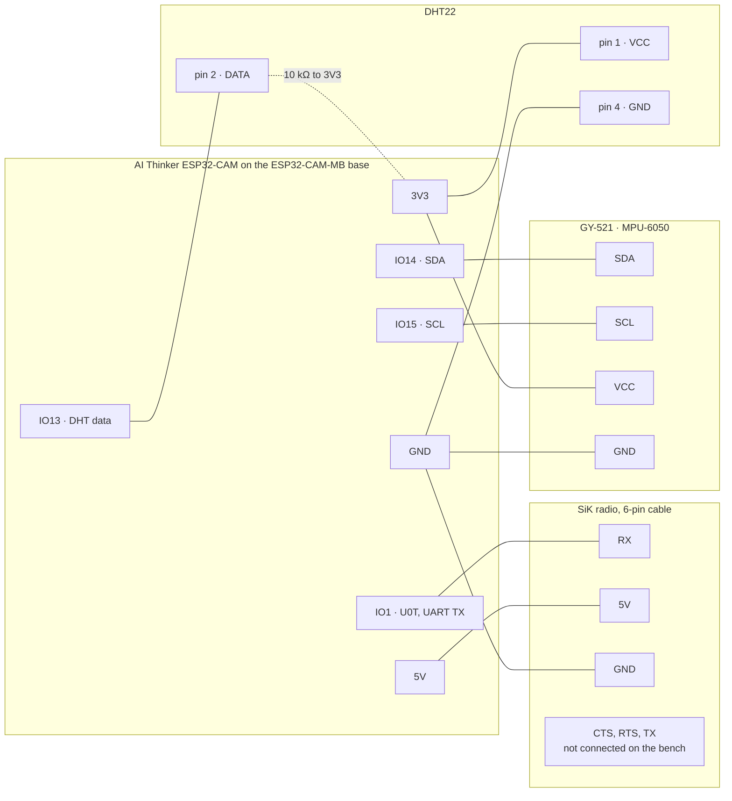
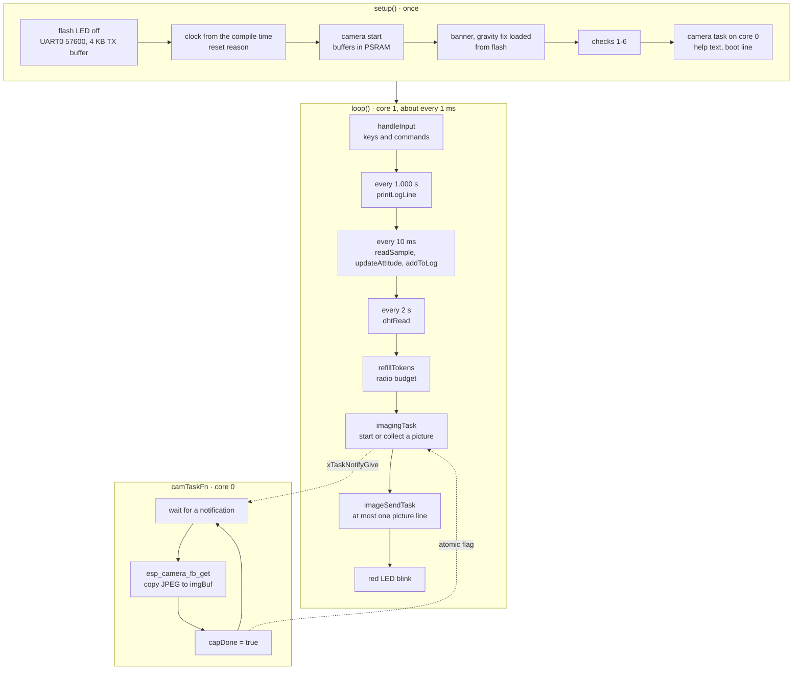
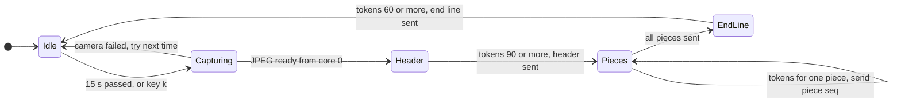

<p align="center"></p>

# Space segment · the DUSK-1 CanSat

The CanSat measures its environment and its motion, takes pictures, and sends everything to the ground over a
915 MHz radio. This page explains the equipment, the wiring, how to build it, and **every part of its firmware**,
[`firmware/DUSK1_Telemetry_Cam/DUSK1_Telemetry_Cam.ino`](firmware/DUSK1_Telemetry_Cam/DUSK1_Telemetry_Cam.ino).

| | |
|---|---|
| Computer | AI Thinker ESP32-CAM (ESP32, dual core 240 MHz, PSRAM) on an ESP32-CAM-MB USB base |
| Sensors | MPU-6050 accelerometer + gyroscope, DHT22 temperature + humidity, OV2640 camera |
| Radio | Holybro SiK telemetry radio, 915 MHz, firmware *RFD SiK 2.0 on HM-TRP*, 100 mW |
| Output | 1 telemetry line per second, 1 picture every 15 s, at 57 600 baud |
| Firmware | one Arduino sketch, **no libraries**, board *AI Thinker ESP32-CAM* |

## Contents

1. [Equipment](#equipment)
2. [Wiring and power](#wiring-and-power)
3. [The radio](#the-radio)
4. [Build and upload](#build-and-upload)
5. [Firmware architecture](#firmware-architecture)
6. [Start-up checks](#start-up-checks)
7. [Sensors and processing](#sensors-and-processing)
8. [Telemetry protocol](#telemetry-protocol)
9. [Picture protocol](#picture-protocol)
10. [Commands (keys)](#commands-keys)
11. [Settings in the code](#settings-in-the-code)
12. [LEDs](#leds)
13. [Troubleshooting](#troubleshooting)

---

## Equipment

| Part | What it does in DUSK-1 | Key facts |
|---|---|---|
| **AI Thinker ESP32-CAM** | the flight computer: reads the sensors, runs the camera, formats and sends every line | ESP32 dual core, 4 MB PSRAM for camera buffers, OV2640 connector, microSD slot (not used: its pins are our sensor pins) |
| **ESP32-CAM-MB** | USB base for the bench: power, upload, Serial Monitor | CH340 USB-serial chip, auto-reset circuit |
| **OV2640 camera** | the pictures | 2 MP sensor, we use 320×240 JPEG (also 160×120, 640×480) |
| **MPU-6050 on a GY-521 board** | acceleration and rotation, for attitude and flight events | 3-axis ±16 g accelerometer, 3-axis ±2000 °/s gyroscope, I2C address 0x68 |
| **DHT22 (AM2302)** | air temperature and humidity | −40 to 80 °C, 0–100 % RH, one reading per 2 s, single-wire protocol |
| **10 kΩ resistor** | pull-up on the DHT22 data line | only for the bare 4-pin DHT22 |
| **Holybro SiK telemetry radio + antenna** | the downlink (and the uplink in the flight build) | 915–928 MHz frequency hopping, 50 channels, 64 kbit/s air rate, transparent serial at 57 600 baud |
| **Breadboard, jumper wires** | 3V3 and GND rails, sensor connections | connect or disconnect only with the USB cable unplugged |

## Wiring and power



| From | To | Note |
|---|---|---|
| MPU-6050 VCC, GND | 3V3 rail, GND rail | |
| MPU-6050 SDA, SCL | IO14, IO15 | I2C at 400 kHz (falls back to 100 kHz) |
| DHT22 pin 1, pin 4 | 3V3 rail, GND rail | pin 3 is not used |
| DHT22 pin 2 (DATA) | IO13, and 10 kΩ to 3V3 | keep the wire short |
| Radio RX | IO1 (U0T) | the radio hears everything the CanSat prints |
| Radio 5V, GND | 5V, GND | the radio takes up to ~500 mA when sending at full power |
| Radio TX | *not connected on the bench* | in the flight build, without the MB base, it goes to IO3 (U0R) so commands reach the CanSat |
| Radio CTS, RTS | **not connected, and not touching GND** | CTS on GND at power-up puts the radio in firmware-update mode (solid red LED) |

**Take the microSD card out.** IO13, IO14 and IO15 are also the card's pins.

**Power.** On the bench everything runs from the laptop's USB through the ESP32-CAM-MB. The camera and a radio at
full power (500 mW) can need more than one USB port gives: if the boot line says `reset brownout`, set the radio
to 100 mW (`ATS4=20`, which our radios already have) and put a 470 µF capacitor across the radio's 5V and GND.

## The radio

Both radios of the pair must have **identical settings**, and their network ID must be **private**: the factory
value 25 is shared by every other team's radio, and a radio pairs with whichever radio on its ID it hears first.
That really happened to us (see the main README). Read or set a radio over its micro-USB port with
[`ground-segment/tools/sik_radio_config.py`](https://github.com/0-Mousa-0/DUSK-1/blob/ground-segment/ground-segment/tools/sik_radio_config.py).

| Register | Setting | Our value |
|---|---|---|
| S1 SERIAL_SPEED | serial speed to the ESP32 | 57 (= 57 600 baud, matches `SERIAL_BAUD`) |
| S2 AIR_SPEED | air data rate | 64 kbit/s |
| S3 NETID | network ID, the same on both radios | a private value, not 25 |
| S4 TXPOWER | transmit power | 20 dBm = 100 mW |
| S5 ECC | error correction | 0 |
| S6 MAVLINK | framing | 1 |
| S8, S9 MIN/MAX_FREQ | band | 915 000 – 928 000 kHz |
| S10 NUM_CHANNELS | hopping channels | 50 |
| S14 RTSCTS | flow control | 0 |

| Radio LED | Meaning |
|---|---|
| green blinking | searching for its partner |
| green solid | linked |
| red flashing | sending data |
| red solid | firmware-update (bootloader) mode: no data passes. Power it off and on with CTS free |

## Build and upload

**Arduino IDE:** install *esp32 by Espressif Systems* in the Boards Manager, choose the board **AI Thinker ESP32-CAM**.
No libraries are needed: the camera, I2C, base64 and preferences come with the board package.

1. Unplug the radio's RX wire (it would load the TX line during upload).
2. Put a jumper from **GPIO 0 to GND**, press **RST**.
3. **Upload**.
4. Remove the jumper, plug the radio RX back in (USB unplugged), press **RST**.
5. Serial Monitor at **57600**: the start-up checks print, then one line per second.

The same build runs on every push to this branch (GitHub Actions, `arduino-cli`, ESP32 core 3.3.12,
FQBN `esp32:esp32:esp32cam`): about 457 kB of 3 MB flash, 38 kB of RAM.

---

## Firmware architecture

The sketch does everything in a non-blocking `loop()` on core 1, with fixed schedules that never drift, while a
FreeRTOS task on core 0 takes pictures, so a picture never interrupts the 100 Hz sensor reads.



| Part of the code | What it does |
|---|---|
| `SETTINGS` block | every pin, rate, limit and default in one place (see [Settings](#settings-in-the-code)) |
| I2C helpers `writeReg`, `readRegs`, `startBus`, `i2cScan` | talk to the MPU-6050; the bus has a 20 ms timeout so a loose wire never hangs the CanSat |
| `result()` | prints one aligned PASS / WARN / FAIL line and counts the results |
| Gravity fix storage `loadCal`, `saveCal`, `clearCal` | keeps the accelerometer calibration in flash (`Preferences`, namespace `dusk-imu`), so it survives resets and re-uploads |
| `readSample`, `correctAccel` | one 14-byte burst read: acceleration, temperature, rotation; then the gravity fix and the gyro bias |
| `configure` | writes the flight settings to the MPU-6050 and reads them back |
| `resetAttitude`, `updateAttitude` | roll and pitch: complementary filter |
| `stillTest` | 3 s of readings at rest: noise, gyro bias, gravity, chip temperature, I2C errors; zeroes Z |
| DHT22 driver `dhtReadRaw`, `dhtDecode`, `dhtRead`, `dhtCheck` | reads the DHT22 by timing its pulses, no library |
| Gravity fix `gravityFixZ` (key z), `gravityFix6` (key 6) | guided calibration in 2 or 6 positions |
| `bringUpMpu` | checks 1 to 4, also used when the MPU-6050 comes back after a fault |
| Clock `setClock`, `setClockFromBuild`, `clockString` | the timestamp of every line; starts from the compile time, set exactly from the ground |
| `printLogLine` | builds and sends the telemetry line, charges it to the radio budget |
| Camera `cameraStart`, `camTaskFn`, `cameraCheck` | camera driver, the core-0 capture task, check 6 |
| `refillTokens`, `imagingTask`, `imageSendTask` | when to take a picture, and sending it in pieces within the radio budget |
| `cycleImageSize`, `cycleImagePeriod` | keys v and i |
| `printHelp`, `printPlot` | help text, Serial Plotter views |
| `runKey`, `processLine`, `handleInput` | everything typed in the Serial Monitor or sent from the ground |
| `setup`, `loop` | start-up sequence and the scheduler above |

**Why the schedules never drift:** each deadline adds exactly its period to the previous deadline
(`tNextLog += LOG_MS`) instead of waiting with `delay()`. Telemetry lines land on whole seconds, and every line
averages exactly 100 sensor readings.

## Start-up checks

At every power-up the CanSat tests itself and prints a report like this (the dashboard's console shows it too):

```
[1/6] I2C scan on SDA=IO14, SCL=IO15
      found 0x68   MPU-6050 (AD0 = GND)
[2/6] MPU-6050 chip ID
      WHO_AM_I         0x68 at address 0x68       0x68             PASS
[3/6] Configure with the flight settings
      write+readback   ±16 g, ±2000 °/s, 44 Hz    matches          PASS
[4/6] Still test - do not touch the board or the table for 4 seconds
      gravity corr.    1.000 g = 9.807 m/s²       9.51 - 10.10     PASS
      ...
[5/6] DHT22 on IO13
[6/6] Camera OV2640
      test picture     320x240, 7412 bytes, 61 ms JPEG             PASS
Dusk1-2026-10-20 19:37:31:> boot | reset power-on | mpu ok | dht ok | cam ok | gravity zeroed at start-up
```

| Check | Test | Limit |
|---|---|---|
| 1 · I2C scan | something answers at 0x68 or 0x69; retries at 100 kHz | MPU-6050 found |
| 2 · chip ID | `WHO_AM_I` register | 0x68 (a clone: WARN, continues) |
| 3 · configure | writes ±16 g, ±2000 °/s, 44 Hz filter, 100 Hz, wakes the chip, reads it back | all match |
| 4 · still test (3 s, 300 readings) | gravity after correction | 0.97–1.03 g (9.51–10.10 m/s²) |
| | accelerometer noise | < 20 mg; FAIL if every reading is identical (sensor asleep) |
| | gyro bias | < 10 °/s PASS, < 20 °/s WARN; then saved and removed from every reading |
| | gyro noise | < 0.50 °/s |
| | chip temperature | 0–70 °C |
| | I2C link | 0 failed reads |
| 5 · DHT22 | a valid reading in 3 tries; temperature and humidity in range; compared with the MPU chip temperature | within ±8 °C |
| 6 · camera | camera started, a real JPEG (starts with FF D8) after 3 frames for the exposure to settle; prints the time a picture will take on the radio | JPEG |

If the board moved during the still test, the gyro bias is not saved and the report says so (`type c to repeat`).
If the MPU-6050 is missing, the telemetry keeps running without it and the sensor is retried every 3 s; when it
answers, checks 1–4 run again.

## Sensors and processing

### MPU-6050: acceleration and rotation

* **Flight settings:** ±16 g (2048 LSB/g), ±2000 °/s (16.4 LSB per °/s), digital low-pass filter 44 Hz, sample rate 100 Hz.
* **Reading:** one burst of 14 registers from `0x3B` every 10 ms: three accelerations, the chip temperature
  (`raw / 340 + 36.53` °C), three rotation rates.
* **Gravity correction**, applied as `a = (raw − offset) / scale` per axis, chosen in this order:
  1. a **saved fix** measured with key `z` (Z flat and upside down) or `6` (all six faces): it knows the offset and
     the scale of each axis and is kept in flash;
  2. otherwise **zeroed at start-up**: during the still test the Z offset is chosen so the board reads exactly 1 g;
  3. otherwise the **code default** `ACC_Z_OFFSET_DEFAULT = −0.320 g` (our board read 0.680 g flat).
* **Gyro bias** measured in the still test is subtracted, so a CanSat at rest reads 0.00 °/s.
* **Attitude**, a complementary filter at 100 Hz: the gyro follows fast motion, gravity removes the drift.

  `roll = 0.98 · (roll + gx·dt) + 0.02 · atan2(ay, az)`
  `pitch = 0.98 · (pitch + gy·dt) + 0.02 · atan2(−ax, √(ay² + az²))`

* **Every telemetry line is the average of that second's 100 readings**, converted to m/s² (× 9.80665) for
  acceleration. `|a|` is the average of each reading's magnitude √(ax² + ay² + az²). At rest it is 9.81 m/s² = 1 g;
  at launch or parachute opening it rises; in free fall it drops towards 0.

### DHT22: temperature and humidity

The DHT22 driver needs no library. The CanSat pulls the data line low for 1.1 ms; the sensor answers 80 µs low +
80 µs high, then sends 40 bits. Each bit is a ~50 µs low followed by a high: ~27 µs means 0, ~70 µs means 1. The
40 bits are humidity ×10 (2 bytes), temperature ×10 (2 bytes, top bit = minus) and a checksum byte. Reading takes
~5 ms with interrupts off, for exact timing. The DHT22 can measure once every 2 s; if no good reading arrived for
5 s, the telemetry sends `--` instead of a stale value.

### OV2640: pictures

The camera starts with buffers big enough for 640×480 in PSRAM (two buffers, always the newest picture), JPEG
quality 12. Pictures are taken by a task on core 0; the main loop only notifies it and later collects the result
through an atomic flag.

## Telemetry protocol

One line per second, plain text, so it is readable in any Serial Monitor and easy to decode on the ground:

```
Dusk1-2026-10-20 19:37:32:> pkt 1 | T 23.5 | RH 29.2 | ax +0.08 | ay -0.25 | az +10.04 | |a| 10.09 | gx -0.92 | gy -1.54 | gz -0.00 | roll +3.1 | pitch +4.8 | n 100 | err 0
```

| Field | Unit | Meaning |
|---|---|---|
| `Dusk1-<date time>:>` | | the CanSat's clock (from the compile time until set from the ground) |
| `pkt` | | line number from 1. A gap on the ground = lines lost on the radio |
| `T` | °C | DHT22 temperature, `--` if no valid reading for 5 s |
| `RH` | % | DHT22 relative humidity |
| `ax`, `ay`, `az` | m/s² | acceleration per axis, gravity corrected, average of the second |
| `\|a\|` | m/s² | total acceleration (9.81 at rest) |
| `gx`, `gy`, `gz` | °/s | rotation rate per axis, bias removed |
| `roll`, `pitch` | ° | attitude from the complementary filter |
| `n` | | MPU-6050 readings in that second (100 when healthy) |
| `err` | | I2C read errors in that second (0 when the wiring is good) |

Other lines from the CanSat:

| Line | When |
|---|---|
| `Dusk1-<time>:> boot \| reset power-on \| mpu ok \| dht ok \| cam ok \| gravity zeroed at start-up` | once after the checks: reset reason (power-on, reset pin, software, crash, watchdog, brownout) and each part's state |
| `Dusk1-<time>:> clock set` | after the date and time were set |
| start-up checks, help, replies to keys | readable text; the ground shows it in the console |

## Picture protocol

A JPEG (about 6–8 kB at 320×240) is sent as a header, numbered pieces, and an end line, between telemetry lines:

```
Dusk1-2026-10-20 19:37:34:> img 1 start | 320x240 | 3624 bytes | 19 chunks
Dusk1-img:> 1 0 /9j/4AAQSkZJRgABAQAAAQABAAD/2wBD...*0D
Dusk1-img:> 1 1 AAAAAAAAAAECAwQFBgcICQoL/8QAtRAA...*67
...
Dusk1-2026-10-20 19:37:34:> img 1 end | 19 chunks | 4.0 s
```

* Each piece carries **192 bytes** of the JPEG as 256 base64 characters, the picture number and the piece number.
* After `*` comes an **XOR checksum** (two hex digits) of everything before it. The ground drops a damaged piece and
  rebuilds the picture with a grey band where a piece is missing, instead of losing the whole picture.
* **Radio budget.** A token bucket shares the radio between telemetry and pictures: tokens refill at
  `bps` bytes per second (default 2000, max 600 stored), every line spends its length, and a picture line is sent
  only when enough tokens are there and the UART buffer has room. Telemetry is never delayed. A 320×240 picture
  takes about 4–5 s.



## Commands (keys)

Type in the Serial Monitor (any line ending), or send from the dashboard's Commands tab:

| Key | Action |
|---|---|
| `2026-10-20 19:30:00` | set date and time (the dashboard's *Sync CanSat clock* sends the laptop's time) |
| `19:30:00` | set the time only |
| `k` | take a picture now |
| `i` | picture interval: 10 → 15 → 30 → 60 s → off |
| `v` | picture size: 320×240 → 640×480 → 160×120 |
| `bps 1500` | radio budget for pictures, 300–5000 bytes/s (lower it if pictures arrive with gaps) |
| `c` | still test again (zeroes Z, re-measures the gyro bias) |
| `d` | DHT22 check |
| `s` | I2C scan |
| `z` | gravity fix, Z axis: 2 positions, about 20 s, saved in flash |
| `6` | gravity fix, all axes: 6 positions, about 1 minute, saved in flash |
| `0` | clear the saved gravity fix |
| `l` | live log (telemetry lines, the default) |
| `p` / `a` / `g` / `e` | Serial Plotter views: roll and pitch / acceleration / rotation / temperature and humidity |
| `x` | pause / resume |
| `h` | help |

On the bench the radio TX is not wired, so commands work through the USB Serial Monitor. In the flight build the
radio TX goes to IO3 and the same commands arrive from the ground station.

## Settings in the code

| Setting | Value | Why |
|---|---|---|
| `SERIAL_BAUD` | 57600 | the SiK radio's serial speed |
| `PIN_SDA`, `PIN_SCL`, `PIN_DHT` | 14, 15, 13 | free pins on the ESP32-CAM (the microSD pins) |
| `I2C_HZ` | 400 000 | fast mode, falls back to 100 kHz |
| `ACCEL_FS_SEL`, `GYRO_FS_SEL` | 3, 3 | ±16 g and ±2000 °/s: flight shocks do not saturate |
| `SAMPLE_MS`, `LOG_MS` | 10, 1000 | 100 Hz sampling, one line per second |
| `DHT_MS`, `DHT_STALE_MS` | 2000, 5000 | the DHT22's fastest rate; when to send `--` |
| `STILL_SAMPLES`, `POSE_SAMPLES` | 300, 200 | 3 s still test, 2 s per calibration position |
| `ACC_Z_OFFSET_DEFAULT` | −0.320 g | measured on our board |
| `SERIAL_TX_BUF` | 4096 | printing never blocks the sensor reads |
| `IMG_PERIOD_S_DEFAULT` | 15 | automatic picture period |
| `IMG_QUALITY` | 12 | JPEG quality (10 best … 63 smallest) |
| `IMG_CHUNK_RAW` | 192 | JPEG bytes per piece (256 base64 characters) |
| `LINK_BPS_DEFAULT` | 2000 | radio bytes per second for pictures |
| `IMG_BUF_BYTES` | 160 kB | largest JPEG kept (in PSRAM) |

## LEDs

| LED | Meaning |
|---|---|
| small red LED on the back (IO33) | slow blink (0.5 s): all sensors fine · fast blink (0.1 s): the MPU-6050 or the DHT22 is missing |
| big white flash (IO4) | kept off |

## Troubleshooting

| Symptom | Cause and fix |
|---|---|
| `MPU-6050 not found` | VCC on 3V3, GND, SDA on IO14, SCL on IO15, GY-521 pins soldered, microSD removed, the GY-521 LED lit |
| `gravity corr.` FAIL | type `z` for the 20-second gravity fix (flat, then upside down) |
| `DHT22 read` no answer | pin 1 on 3V3, pin 2 on IO13 with 10 kΩ to 3V3, pin 4 on GND, microSD removed |
| DHT22 answers but data damaged | check the 10 kΩ pull-up, push the wires in firmly, keep the data wire short |
| `camera start` FAIL | ribbon cable pushed fully in with the latch closed; a firm USB cable (the camera needs extra current) |
| `Last reset: brownout` | 5 V dipped: radio at 100 mW (`ATS4=20`), 470 µF across the radio's 5V and GND |
| strange characters only at a reset | the ESP32's own boot text at 115200 baud; code cannot switch it off, the ground station hides it |
| radio LED solid red | firmware-update mode: CTS was on GND at power-up. Free CTS, power off and on |
| radio solid green but the ground hears nothing | it paired with someone else's radio: give both of ours the same private NETID |
| pictures arrive with gaps | lower the radio budget, e.g. `bps 1500` |
